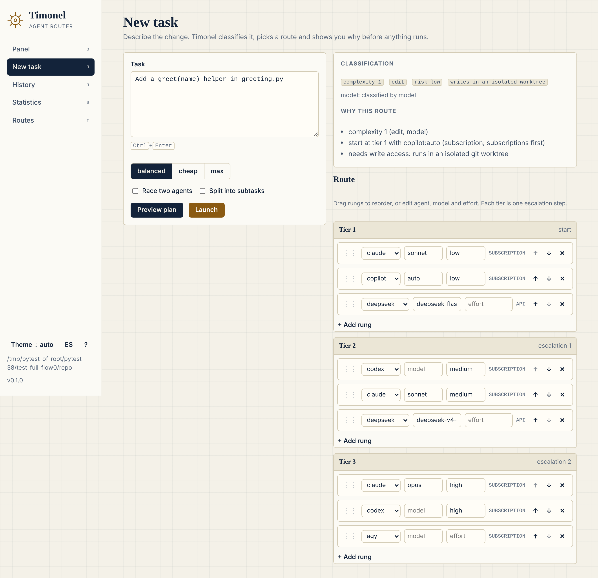
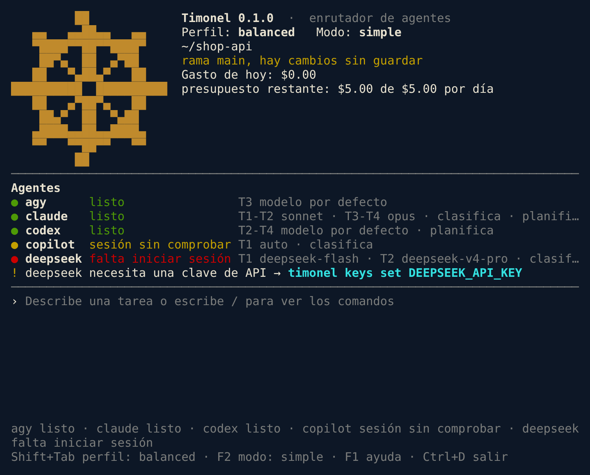
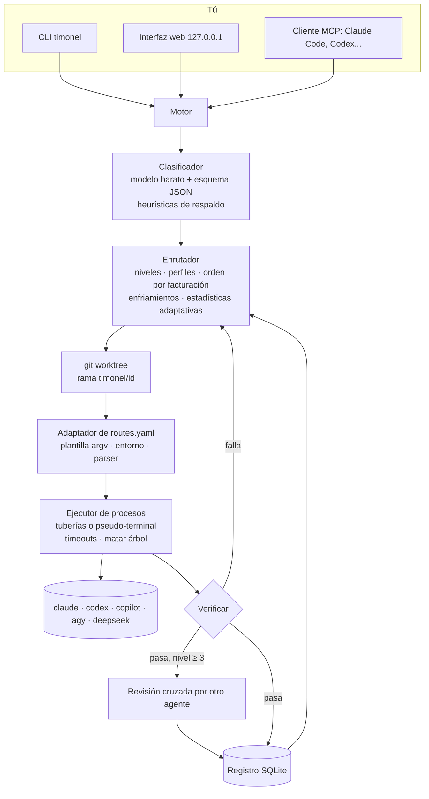
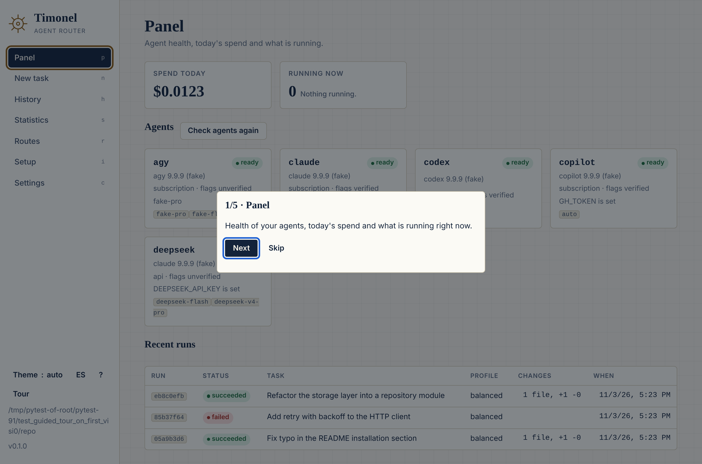
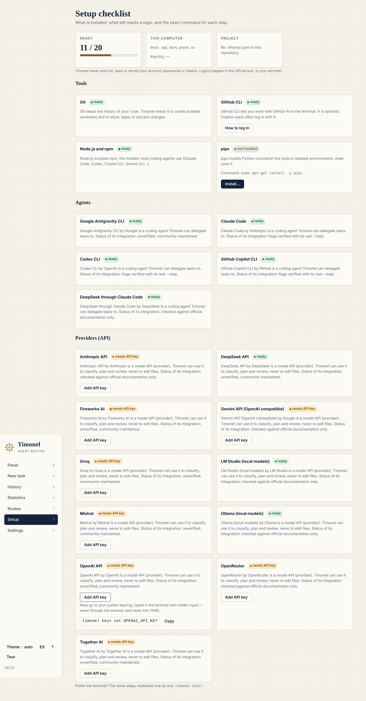
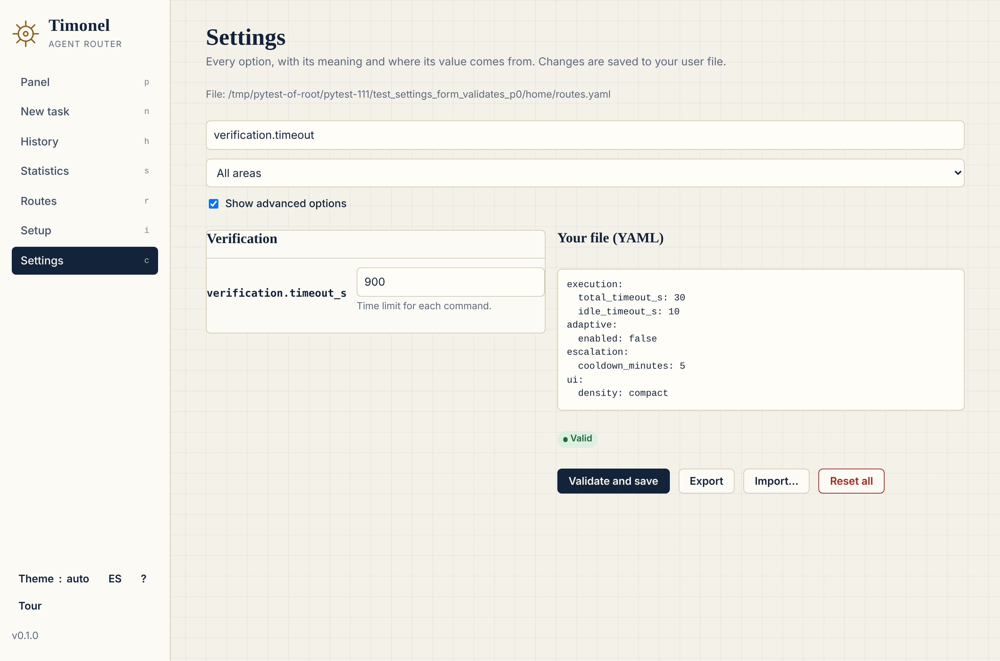
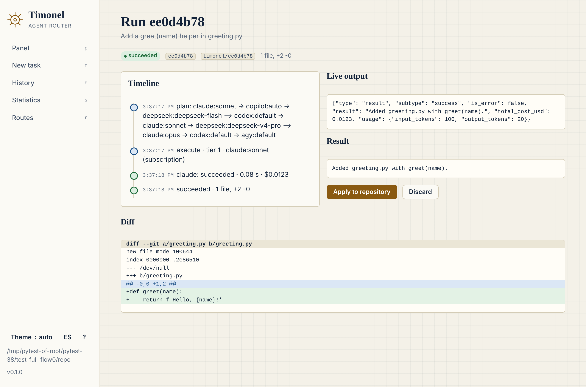
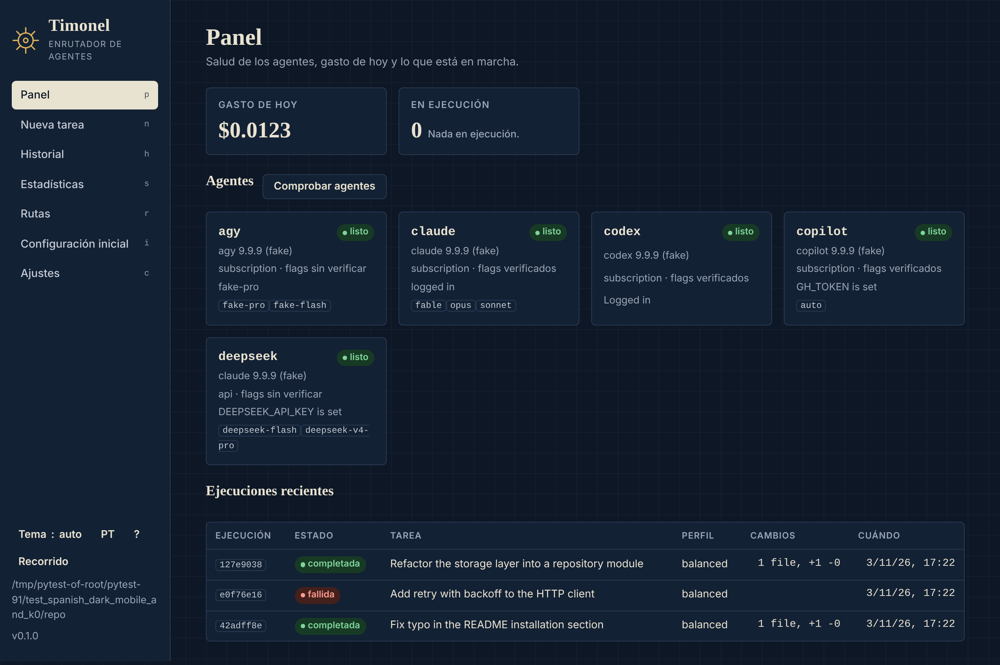

<p align="center">
  
</p>

<h1 align="center">Timonel</h1>

<p align="center">
  <b>Envía cada tarea de programación al agente y modelo adecuados. Escala solo cuando falla.</b><br>
  Claude Code · Codex · GitHub Copilot · Gemini CLI · Qwen Code · OpenCode · Aider · y más
</p>

<p align="center">
  <a href="https://github.com/EduMayMar/Timonel/actions/workflows/ci.yml"></a>
  
  
  <a href="LICENSE"></a>
  
  
</p>

<p align="center"><a href="README.md">Read in English</a></p>

<p align="center">
  
</p>

Le das una tarea a Timonel; decide qué tan difícil es, elige una escalera de agentes y modelos,
ejecuta el más barato que sirva en un `git worktree` aislado, verifica el resultado con tus pruebas
y, si fallan, escala a un modelo más fuerte pasándole el error como contexto. Nada toca tu rama hasta
que lo apliques.

- **Un solo comando para todos los agentes de terminal que ya pagas.** 16 conectores de agentes y 11
  APIs de modelos, cada uno con la fecha y versión en que se comprobaron sus flags. Dentro de un nivel
  se usan antes las suscripciones que las APIs de pago por uso.
- **Pensado también para principiantes.** `timonel start` instala y explica cada pieza,
  `timonel demo` enseña todo el flujo con agentes simulados, `timonel learn` explica los conceptos y
  cada error tiene un código `TMN-xxxx` con la solución.
- **Privado y seguro por defecto.** Timonel nunca pide, ve ni guarda las contraseñas ni los tokens de
  tus cuentas; las claves de API van al llavero del sistema. Sin telemetría. Las ediciones ocurren en
  worktrees, sin shell, con secretos limitados a un proceso y redactados en todo lo demás.
- **Explica cada decisión.** `timonel plan` muestra la clasificación, la ruta y el porqué sin ejecutar
  nada; `--explain` funciona en cualquier comando.
- **Todo es configurable.** Un único JSON Schema alimenta la validación, `timonel config`, la
  documentación y la página de ajustes. Capas: defecto, usuario, proyecto de confianza, entorno, `--set`.
- **Interfaz web local.** Recorrido guiado, lista de configuración, ajustes generados desde el
  esquema, línea de tiempo en vivo, diffs, aplicar con un clic, estadísticas y editor de rutas. En
  español, inglés y portugués, claro y oscuro, usable con teclado y lector de pantalla.

## Inicio rápido (60 segundos)

```bash
pipx install git+https://github.com/EduMayMar/Timonel   # o: uv tool install git+https://github.com/EduMayMar/Timonel
timonel demo              # mira todo el flujo con agentes simulados, sin instalar nada
timonel start             # configuración guiada: Git, Node.js y los agentes que elijas, paso a paso
cd ruta/a/tu/repo
timonel plan "Corrige el fallo cuando config.yaml está vacío"
timonel run "Corrige el fallo cuando config.yaml está vacío"
timonel diff <id>         # revisa
timonel apply <id>        # fusiona la rama timonel/<id> en tu rama
timonel ui                # o hazlo todo desde el navegador
```

Instaladores que muestran lo que van a hacer antes de hacerlo:
[`install/install.sh`](install/install.sh) e [`install/install.ps1`](install/install.ps1). Cada
versión incluye binarios de un solo archivo para Windows, macOS y Linux y una imagen de contenedor.
Guía paso a paso en español: [docs/quickstart.es.md](docs/quickstart.es.md).

## La pantalla de inicio

Escribe solo `timonel` y aparece una pantalla de inicio en la terminal: el estado de cada agente
(comprobado en segundo plano), el gasto de hoy, avisos con el comando exacto que resuelve cada uno y
una caja de entrada. Escribe una tarea con tus palabras, o `/` para ver los comandos; Timonel enseña
el plan y pregunta antes de ejecutarla. Detalles: [docs/terminal.md](docs/terminal.md).



## Cómo funciona



1. **Clasificar.** Un modelo barato devuelve `{complexity 1-4, kind, risk, needs_write, estimated_files}`.
   La respuesta debe cumplir un esquema; si no, deciden heurísticas deterministas.
2. **Enrutar.** El nivel inicial es la complejidad, ajustada por riesgo y perfil. Cada nivel es una
   escalera ordenada de `(agente, modelo, esfuerzo)`; las suscripciones van primero.
3. **Ejecutar.** Las ediciones corren en `git worktree` sobre `timonel/<id>`; las explicaciones y
   revisiones corren en modo solo lectura en el propio repositorio.
4. **Verificar y escalar.** Tus comandos deciden. Un fallo pasa al siguiente nivel con el error
   recortado. Los cuelgues, timeouts, salidas ilegibles y límites de uso pasan al siguiente peldaño
   del mismo nivel, y los límites de uso dejan al agente en enfriamiento.
5. **Revisar.** Desde el nivel 3, otro agente revisa el diff; si lo rechaza hay una ronda de
   corrección.
6. **Registrar.** Cada intento, su costo (real si el CLI lo informa, estimado si no) y su resultado
   van al registro, que alimenta `stats`, el ahorro y el enrutamiento adaptativo.

Más detalle en [docs/concepts.md](docs/concepts.md) (en inglés).

## Agentes

Agentes (CLIs de programación que editan archivos en un worktree): Claude Code, Codex CLI, GitHub
Copilot CLI, Gemini CLI, Qwen Code, OpenCode, Amp, Crush, Cline, Factory Droid, Kimi Code, Aider y
DeepSeek a través de Claude Code tienen los flags verificados con su propio `--help`; Cursor CLI solo
con documentación; Google Antigravity y Goose son entradas comunitarias, no verificadas.

Proveedores (APIs HTTP de modelos para clasificar, planificar y revisar, nunca para editar): OpenAI,
Anthropic, Gemini API, OpenRouter, Ollama, LM Studio, Groq, Mistral, Together, Fireworks y la API de
DeepSeek.

Los conectores nuevos empiezan desactivados: `timonel agents list`, `timonel agents enable <nombre>`,
`timonel agents test <nombre>`. La tabla completa con versiones y fechas está en
[docs/connectors.md](docs/connectors.md); añadir uno es un archivo YAML
([docs/adding-an-agent.md](docs/adding-an-agent.md)). Un workflow nocturno vuelve a leer el `--help`
de cada CLI y abre un issue si desaparece un flag.

## Perfiles

| Perfil | Empieza en | Escala hasta | Úsalo para |
|---|---|---|---|
| `cheap` | complejidad − 1 | nivel 3, una vez | Tareas en lote donde manda el costo |
| `balanced` (por defecto) | complejidad | 2 niveles más | El día a día |
| `max` | nivel 4 | nivel 4 | Cuando tiene que salir bien a la primera |

Los perfiles son datos de configuración; crea los tuyos con `timonel profiles create`.

## Comandos

| Comando | Qué hace |
|---|---|
| `timonel start [--dry-run] [--agents a,b]` | Instalación guiada y comprobación de sesión, paso a paso |
| `timonel demo` · `learn [tema]` | Ejecución simulada completa · explicaciones en lenguaje sencillo |
| `timonel doctor [--smoke] [--fix]` | Agentes instalados, versiones, sesión, modelos; `--fix` propone el arreglo de cada problema |
| `timonel plan "tarea"` | Clasificación, ruta y razones sin ejecutar |
| `timonel run "tarea"` | Ejecuta con `--profile`, `--force agente[:modelo]`, `--verify CMD`, `--race`, `--decompose` |
| `timonel status [id]` · `diff id` · `apply id` · `discard id` · `resume id` | Seguir, revisar, conservar o descartar una ejecución |
| `timonel stats` | Éxito, costo y latencia por agente, nivel y tipo de tarea; ahorro frente a usar siempre el nivel más alto |
| `timonel agents list\|info\|enable\|disable\|test\|add\|remove` | Gestiona conectores |
| `timonel config list\|get\|set\|unset\|explain\|edit\|validate\|export\|import\|reset\|schema` | Todas las opciones, con su capa y significado |
| `timonel profiles` · `mode simple\|expert` · `trust` · `keys` · `purge` | Perfiles, modo simple o experto, confianza del proyecto, llavero, retención |
| `timonel ui` · `mcp` | Interfaz web local · servidor MCP por stdio |

Añade `--explain` a cualquier comando para ver qué hará, `--lang es|en|pt` para cambiar el idioma y
`--set clave=valor` para cambiar una opción puntual.

### Usar Timonel desde otro agente (MCP)

```bash
claude mcp add timonel -- timonel mcp
codex mcp add timonel -- timonel mcp
```

El servidor MCP puede planificar, lanzar ejecuciones e informar de su estado, solo en el repositorio
donde se inició; fusionar sigue siendo una decisión humana.

## Interfaz web

`timonel ui` imprime una URL de un solo uso en `127.0.0.1`. El token se canjea por una cookie
estricta, cada petición comprueba `Host`, los cambios de estado exigen el mismo `Origin` y un token
CSRF, y una CSP con nonce bloquea scripts inyectados.

| Recorrido guiado | Lista de configuración |
|---|---|
|  |  |
| **Ajustes desde el esquema** | **Ejecución en vivo** |
|  |  |
| **Español, modo oscuro** | **Editor de rutas** |
|  |  |

Teclado: `p` panel, `n` nueva tarea, `h` historial, `s` estadísticas, `r` rutas, `i` configuración
inicial, `c` ajustes, `t` tema, `l` idioma, `?` ayuda (todo configurable en `ui.shortcuts`). Las
capturas las genera la suite de Playwright contra agentes simulados.

## Configuración

Los valores salen de los valores por defecto, luego tu archivo de usuario
(`~/.config/timonel/routes.yaml` o `%APPDATA%\timonel\routes.yaml`), luego el `.timonel.yaml` del
repositorio **solo después de `timonel trust`**, luego las variables `TIMONEL_SECCION__CLAVE` y por
último `--set clave=valor`.

```bash
timonel config explain review.enabled      # significado, defecto, valor y qué capa lo fijó
timonel config set verification.commands '[["python", "-m", "pytest", "-q"]]'
```

Guías: [configuración](docs/configuration.md), [recetas](docs/recipes.md) (gastar lo mínimo, máxima
calidad, solo Copilot) y la referencia generada en [español](docs/reference/configuration.es.md),
[inglés](docs/reference/configuration.md) y [portugués](docs/reference/configuration.pt.md). Las
claves de API van al llavero del sistema con `timonel keys set NOMBRE`
(`pip install "timonel[keyring]"`) o a variables de entorno, nunca a archivos.

## Preguntas frecuentes

**¿Timonel llama a alguna API de modelos por sí mismo?** Solo a los proveedores que configures (por
ejemplo para clasificar o revisar). Por lo demás ejecuta los CLIs que instalaste, con su propia
sesión. No envía telemetría.

**¿Tocará mi copia de trabajo?** No hasta que ejecutes `timonel apply`. Las ediciones ocurren en un
worktree dentro del directorio de datos de Timonel.

**¿Cómo conoce el costo?** Claude Code informa `total_cost_usd` en su salida JSON (el fabricante lo
llama estimación del lado del cliente). Para otros agentes Timonel estima con tu
`cost_per_attempt_usd` o con costos informados anteriormente, y lo marca como estimado.

**¿Y si un CLI cambia sus flags?** Sobrescribe el adaptador en tu `routes.yaml`, ejecuta
`timonel validate` y `timonel doctor --smoke`. Sin cambiar código ni esperar una versión nueva.

**¿Puedo usar un solo agente?** Sí. `timonel init` conserva solo los agentes que encuentra; con uno
sigues teniendo worktrees, verificación, reintentos entre modelos y el registro.

**¿El ahorro es real?** Compara lo que costaron tus ejecuciones exitosas con el costo medio informado
de los intentos del nivel más alto en tu propio registro. Mientras no haya datos de ambos, muestra
"n/a".

**¿Es seguro ejecutar mis pruebas sobre cambios de un agente?** La verificación ejecuta las pruebas
del proyecto, que el agente pudo haber editado, fuera del sandbox del agente. Timonel quita claves y
tokens de su entorno, pero úsalo solo en repositorios cuyas pruebas ejecutarías de todos modos. Ver
[docs/security.md](docs/security.md).

**¿Puedo automatizar mi suscripción?** Revisa antes los términos de cada plan. Ver
[docs/limits-and-terms.md](docs/limits-and-terms.md).

## Solución de problemas

**`timonel doctor` dice que un agente no está instalado.** El comando debe estar en el `PATH` de la
terminal que lanza Timonel. En Windows, npm instala `claude.cmd`, `codex.cmd` y `copilot.cmd`;
Timonel resuelve esos shims a `node script.js` automáticamente. Por seguridad, en Windows solo se
aceptan ejecutables de carpetas del `PATH`, nunca del directorio actual. Si instalaste un binario
nativo en otro sitio, pon su ruta completa en `agents.<nombre>.command`.

**Windows: "refusing to pass arguments with cmd.exe metacharacters".** El agente es un shim `.cmd`
que no es de npm y el prompt se pasa como argumento. Usa `prompt_via: stdin` (con `prompt_args`
vacío) si el CLI lo admite, o apunta `command` a un `.exe` real.

**`agy` se cuelga o no imprime nada.** Se sabe que `agy -p` se cuelga cuando no ve una terminal
(issue #318 de antigravity-cli). Timonel lo ejecuta en un pseudo-terminal: `pty` en macOS y Linux,
ConPTY mediante `pywinpty` en Windows (se instala solo en Windows). Si `doctor` avisa de que falta
`pywinpty`, ejecuta `pip install pywinpty`. Si aun así se cuelga, baja `--print-timeout` en
`base_args` y abre un issue con la versión.

**Windows: caracteres o saltos de línea extraños.** Timonel lee toda la salida como UTF-8 con
sustitución y normaliza CRLF. Si un agente escribe en otra página de códigos, define `PYTHONUTF8=1` o
configura el CLI para emitir UTF-8.

**Windows: una ejecución espera al timeout de inactividad aunque el agente terminó.** El agente dejó
un proceso en segundo plano (un servidor de desarrollo o un vigilante) con su salida abierta. En macOS
y Linux Timonel detecta que el agente salió y detiene lo que quedó; en Windows espera
`execution.idle_timeout_s`. Baja ese valor o pide al agente que no deje procesos en segundo plano.

**`claude` rechaza `--permission-prompts`.** Requiere Claude Code 2.1.259 o posterior. Actualiza
Claude Code o quita el flag de `agents.claude.base_args`.

**Un agente se salta por "en enfriamiento".** Alcanzó un límite de uso y descansa
`escalation.cooldown_minutes` (30 por defecto). El panel lo indica; baja el valor si tu plan se
renueva antes.

**`apply` dice que hay cambios sin confirmar.** Haz commit o stash antes; Timonel nunca fusiona sobre
un árbol de trabajo sucio.

## Desarrollo

```bash
uv sync --group dev
uv run pytest -q                    # pruebas unitarias, de integración, de propiedades y de navegador
uv run ruff check src tests && uv run mypy
```

El motor se prueba contra CLIs de agente simulados (`tests/fakes/fake_agent.py`) que imitan éxito,
pruebas fallidas, límites de uso, cuelgues, basura, salida parcial y JSON inválido, en Windows, macOS
y Linux. Ver [CONTRIBUTING.md](CONTRIBUTING.md), [SECURITY.md](SECURITY.md) y
[CHANGELOG.md](CHANGELOG.md).

## Licencia

[MIT](LICENSE)
