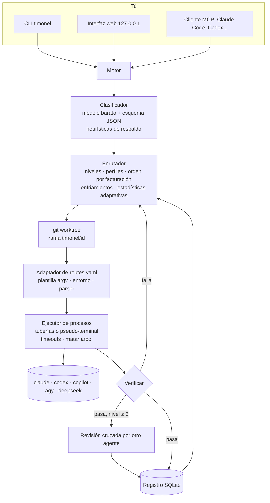
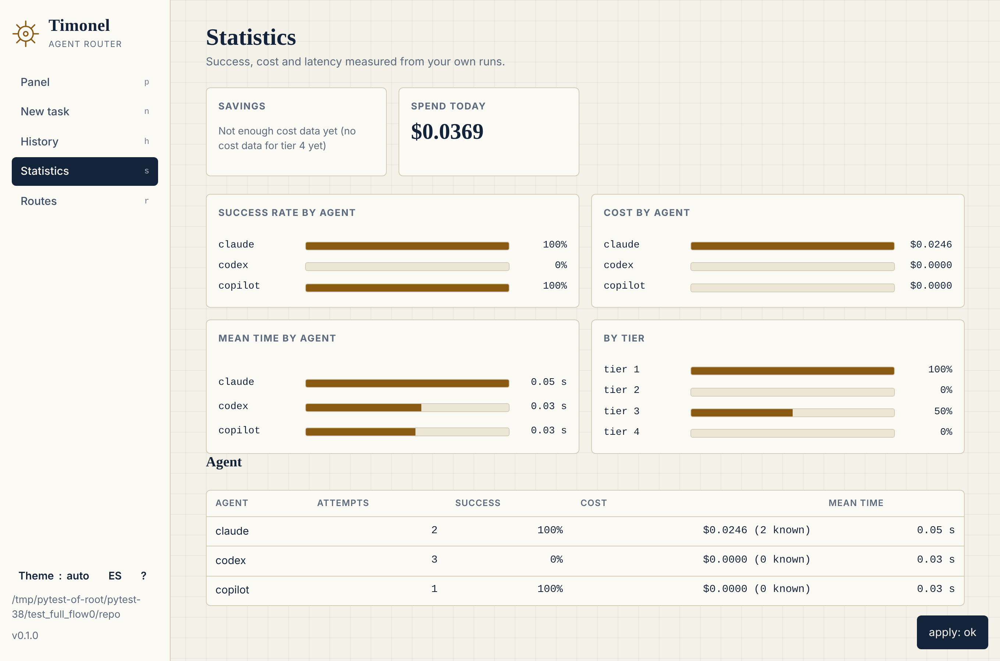
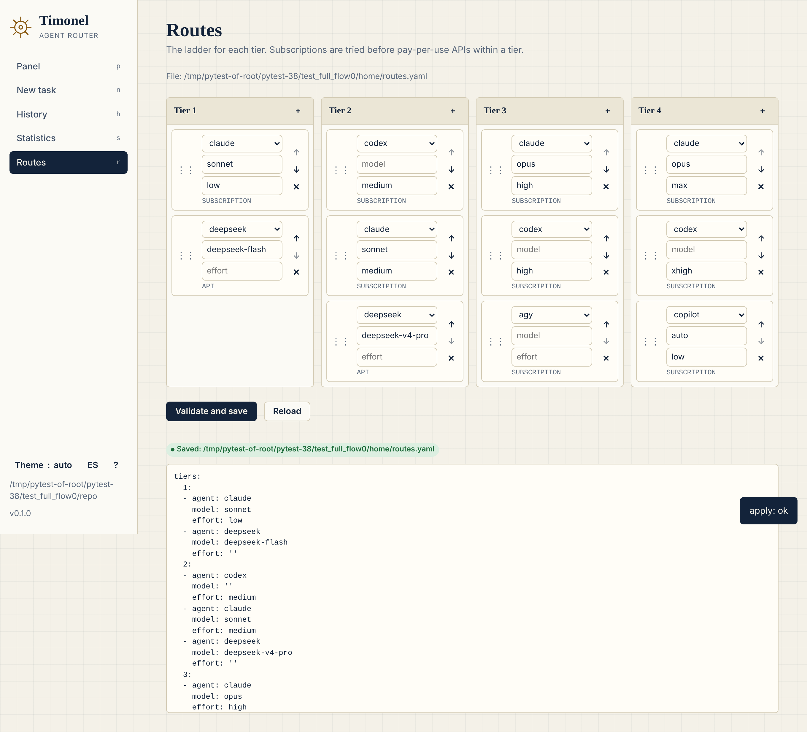

<p align="center">
  
</p>

<h1 align="center">Timonel</h1>

<p align="center">
  <b>Envía cada tarea de programación al agente y modelo adecuados. Escala solo cuando falla.</b><br>
  Claude Code · Codex CLI · GitHub Copilot CLI · Google Antigravity · DeepSeek
</p>

<p align="center">
  <a href="https://github.com/EduMayMar/Timonel/actions/workflows/ci.yml"></a>
  
  
  <a href="LICENSE"></a>
  
  
</p>

<p align="center"><a href="README.md">Read in English</a></p>

<p align="center">
  
</p>

Le das una tarea a Timonel; decide qué tan difícil es, elige una escalera de agentes y modelos,
ejecuta el más barato que sirva en un `git worktree` aislado, verifica el resultado con tus pruebas
y, si fallan, escala a un modelo más fuerte pasándole el error como contexto. Nada toca tu rama hasta
que lo apliques.

- **Un solo comando para todos los agentes de terminal que ya pagas.** Dentro de un mismo nivel se
  usan antes las suscripciones que las APIs de pago por uso.
- **Explica cada decisión.** `timonel plan` muestra la clasificación, la ruta y el porqué sin
  ejecutar nada.
- **Seguro por defecto.** Solo lectura para explicar y revisar, worktrees para editar, sin shell,
  secretos limitados al único proceso que los necesita y redactados en todo lo demás.
- **Adaptadores declarativos.** Cada flag vive en `routes.yaml`. Si un CLI cambia, corriges YAML,
  no código.
- **Aprende de tu registro.** El éxito, el costo y la latencia por tipo de tarea, nivel y agente
  reordenan la escalera, con las cifras que justifican cada elección.
- **Interfaz web local.** Línea de tiempo en vivo, diffs, aplicar con un clic, estadísticas y un
  editor de rutas con arrastrar y soltar. En español e inglés, modo claro y oscuro.

## Inicio rápido (60 segundos)

```bash
uv tool install git+https://github.com/EduMayMar/Timonel   # o: pipx install git+https://github.com/EduMayMar/Timonel
timonel doctor            # qué agentes están instalados y con sesión iniciada
timonel init              # genera routes.yaml con los agentes que tienes
cd ruta/a/tu/repo
timonel plan "Corrige el fallo cuando config.yaml está vacío"
timonel run "Corrige el fallo cuando config.yaml está vacío" --verify "python -m pytest -q"
timonel diff <id>         # revisa
timonel apply <id>        # fusiona la rama timonel/<id> en tu rama
timonel ui                # o hazlo todo desde el navegador
```

Necesitas al menos un CLI de agente instalado y con sesión iniciada: `claude`, `codex`, `copilot` o
`agy`. Para DeepSeek, define `DEEPSEEK_API_KEY` y ten `claude` instalado.

## Cómo funciona



1. **Clasificar.** Un modelo barato devuelve `{complexity 1-4, kind, risk, needs_write, estimated_files}`.
   La respuesta debe cumplir un esquema; si no, deciden heurísticas deterministas.
2. **Enrutar.** El nivel inicial es la complejidad, ajustada por riesgo y perfil. Cada nivel es una
   escalera ordenada de `(agente, modelo, esfuerzo)`; las suscripciones van primero.
3. **Ejecutar.** Las ediciones corren en `git worktree` sobre `timonel/<id>`; las explicaciones y
   revisiones corren en modo solo lectura en el propio repositorio.
4. **Verificar y escalar.** Tus comandos deciden. Un fallo pasa al siguiente nivel con el error
   recortado. Los cuelgues, timeouts, salidas ilegibles y límites de uso pasan al siguiente peldaño
   del mismo nivel, y los límites de uso dejan al agente en enfriamiento.
5. **Revisar.** Desde el nivel 3, otro agente revisa el diff; si lo rechaza hay una ronda de
   corrección.
6. **Registrar.** Cada intento, su costo (real si el CLI lo informa, estimado si no) y su resultado
   van al registro, que alimenta `stats`, el ahorro y el enrutamiento adaptativo.

Más detalle en [docs/concepts.md](docs/concepts.md) (en inglés).

## Agentes

| Agente | Cómo se invoca | Flags | Facturación por defecto |
|---|---|---|---|
| Claude Code | `claude -p`, salida JSON, prompt por stdin | verificados con el `--help` de 2.1.317 | suscripción |
| Codex CLI | `codex exec --json`, prompt por stdin | verificados con el `--help` de 0.166.0 (la clave de esfuerzo no) | suscripción |
| GitHub Copilot CLI | `copilot -p --silent --allow-all-tools --deny-tool=shell` | verificados con el `--help` de 1.0.105 | suscripción |
| Google Antigravity | `agy -p` dentro de un pseudo-terminal | **no verificados** (de issues públicos y chuletas) | suscripción |
| DeepSeek | Claude Code con `ANTHROPIC_BASE_URL=https://api.deepseek.com/anthropic` | flags de Claude verificados, endpoint no | API |

Ejecuta `timonel doctor --smoke` en tu máquina: envía un prompt mínimo de solo lectura a cada agente
y te dice si los flags funcionan. Detalles y fuentes en [docs/agents.md](docs/agents.md).

## Perfiles

| Perfil | Empieza en | Escala hasta | Úsalo para |
|---|---|---|---|
| `cheap` | complejidad − 1 | nivel 3, una vez | Tareas en lote donde manda el costo |
| `balanced` (por defecto) | complejidad | 2 niveles más | El día a día |
| `max` | nivel 4 | nivel 4 | Cuando tiene que salir bien a la primera |

Los perfiles son datos en `routes.yaml`; puedes añadir los tuyos.

## Comandos

| Comando | Qué hace |
|---|---|
| `timonel doctor [--smoke] [--json]` | Agentes instalados, versiones, sesión, modelos; `--smoke` valida los flags con un prompt real |
| `timonel models [agente]` | Modelos por agente (`agy models` y los alias conocidos de cada CLI) |
| `timonel plan "tarea"` | Clasificación, ruta y razones sin ejecutar (`--model-classify` consulta al modelo clasificador) |
| `timonel run "tarea"` | Ejecuta con `--profile`, `--force agente[:modelo]`, `--verify CMD` (repetible), `--race`, `--decompose` |
| `timonel status [id]` · `diff id` | Ejecuciones, intentos, costos, diff |
| `timonel apply id` · `discard id` | Fusiona o borra la rama y el worktree de una ejecución |
| `timonel resume id` | Continúa una ejecución interrumpida |
| `timonel stats` | Éxito, costo y latencia por agente, nivel y tipo de tarea; ahorro frente a usar siempre el nivel más alto |
| `timonel init` · `validate` | Genera o valida `routes.yaml` |
| `timonel ui` | Interfaz web local |
| `timonel mcp` | Servidor MCP por stdio con `timonel_plan`, `timonel_run`, `timonel_status` |

### Usar Timonel desde otro agente (MCP)

```bash
claude mcp add timonel -- timonel mcp
codex mcp add timonel -- timonel mcp
```

El servidor MCP puede planificar, lanzar ejecuciones e informar de su estado, solo en el repositorio
donde se inició; fusionar sigue siendo una decisión humana.

## Interfaz web

`timonel ui` imprime una URL de un solo uso en `127.0.0.1`. El token se canjea por una cookie
estricta, cada petición comprueba `Host`, los cambios de estado exigen el mismo `Origin` y un token
CSRF, y una CSP con nonce bloquea scripts inyectados.

| Panel | Ejecución en vivo |
|---|---|
|  |  |
| **Estadísticas** | **Editor de rutas** |
|  |  |
| **Historial** | **Español, modo oscuro** |
|  |  |

Teclado: `p` panel, `n` nueva tarea, `h` historial, `s` estadísticas, `r` rutas, `t` tema, `l`
idioma, `?` ayuda, `Ctrl+Enter` ver plan y lanzar. Las capturas las genera la suite de Playwright
contra agentes simulados.

## Configuración

Tu `routes.yaml` vive en `~/.config/timonel/` (Linux, macOS) o `%APPDATA%\timonel\` (Windows) y se
combina con los [valores por defecto](src/timonel/default_routes.yaml). Nunca se lee desde el
repositorio que se modifica. Referencia completa: [docs/routes-reference.md](docs/routes-reference.md).

```yaml
execution:
  verify:
    - ["python", "-m", "pytest", "-q"]
agents:
  codex:
    billing: api
  claude:
    cost_per_attempt_usd: 0.05
```

Las claves van en variables de entorno (`DEEPSEEK_API_KEY`, `GH_TOKEN`...) o en el llavero del
sistema bajo el servicio `timonel` (`pip install "timonel[keyring]"`), nunca en archivos.

## Preguntas frecuentes

**¿Timonel llama a alguna API de modelos por sí mismo?** No. Solo ejecuta los CLIs que instalaste,
con sus propias sesiones.

**¿Tocará mi copia de trabajo?** No hasta que ejecutes `timonel apply`. Las ediciones ocurren en un
worktree dentro del directorio de datos de Timonel.

**¿Cómo conoce el costo?** Claude Code informa `total_cost_usd` en su salida JSON (el fabricante lo
llama estimación del lado del cliente). Para otros agentes Timonel estima con tu
`cost_per_attempt_usd` o con costos informados anteriormente, y lo marca como estimado.

**¿Y si un CLI cambia sus flags?** Sobrescribe el adaptador en tu `routes.yaml`, ejecuta
`timonel validate` y `timonel doctor --smoke`. Sin cambiar código ni esperar una versión nueva.

**¿Puedo usar un solo agente?** Sí. `timonel init` conserva solo los agentes que encuentra; con uno
sigues teniendo worktrees, verificación, reintentos entre modelos y el registro.

**¿El ahorro es real?** Compara lo que costaron tus ejecuciones exitosas con el costo medio informado
de los intentos del nivel más alto en tu propio registro. Mientras no haya datos de ambos, muestra
"n/a".

**¿Es seguro ejecutar mis pruebas sobre cambios de un agente?** La verificación ejecuta las pruebas
del proyecto, que el agente pudo haber editado, fuera del sandbox del agente. Timonel quita claves y
tokens de su entorno, pero úsalo solo en repositorios cuyas pruebas ejecutarías de todos modos. Ver
[docs/security.md](docs/security.md).

**¿Puedo automatizar mi suscripción?** Revisa antes los términos de cada plan. Ver
[docs/limits-and-terms.md](docs/limits-and-terms.md).

## Solución de problemas

**`timonel doctor` dice que un agente no está instalado.** El comando debe estar en el `PATH` de la
terminal que lanza Timonel. En Windows, npm instala `claude.cmd`, `codex.cmd` y `copilot.cmd`;
Timonel resuelve esos shims a `node script.js` automáticamente. Por seguridad, en Windows solo se
aceptan ejecutables de carpetas del `PATH`, nunca del directorio actual. Si instalaste un binario
nativo en otro sitio, pon su ruta completa en `agents.<nombre>.command`.

**Windows: "refusing to pass arguments with cmd.exe metacharacters".** El agente es un shim `.cmd`
que no es de npm y el prompt se pasa como argumento. Usa `prompt_via: stdin` (con `prompt_args`
vacío) si el CLI lo admite, o apunta `command` a un `.exe` real.

**`agy` se cuelga o no imprime nada.** Se sabe que `agy -p` se cuelga cuando no ve una terminal
(issue #318 de antigravity-cli). Timonel lo ejecuta en un pseudo-terminal: `pty` en macOS y Linux,
ConPTY mediante `pywinpty` en Windows (se instala solo en Windows). Si `doctor` avisa de que falta
`pywinpty`, ejecuta `pip install pywinpty`. Si aun así se cuelga, baja `--print-timeout` en
`base_args` y abre un issue con la versión.

**Windows: caracteres o saltos de línea extraños.** Timonel lee toda la salida como UTF-8 con
sustitución y normaliza CRLF. Si un agente escribe en otra página de códigos, define `PYTHONUTF8=1` o
configura el CLI para emitir UTF-8.

**`claude` rechaza `--permission-prompts`.** Requiere Claude Code 2.1.259 o posterior. Actualiza
Claude Code o quita el flag de `agents.claude.base_args`.

**Un agente se salta por "en enfriamiento".** Alcanzó un límite de uso y descansa
`execution.cooldown_minutes` (30 por defecto). El panel lo indica; baja el valor si tu plan se
renueva antes.

**`apply` dice que hay cambios sin confirmar.** Haz commit o stash antes; Timonel nunca fusiona sobre
un árbol de trabajo sucio.

## Desarrollo

```bash
uv sync --group dev
uv run pytest -q                    # pruebas unitarias, de integración, de propiedades y de navegador
uv run ruff check src tests && uv run mypy
```

El motor se prueba contra CLIs de agente simulados (`tests/fakes/fake_agent.py`) que imitan éxito,
pruebas fallidas, límites de uso, cuelgues, basura, salida parcial y JSON inválido, en Windows, macOS
y Linux. Ver [CONTRIBUTING.md](CONTRIBUTING.md), [SECURITY.md](SECURITY.md) y
[CHANGELOG.md](CHANGELOG.md).

## Licencia

[MIT](LICENSE)
