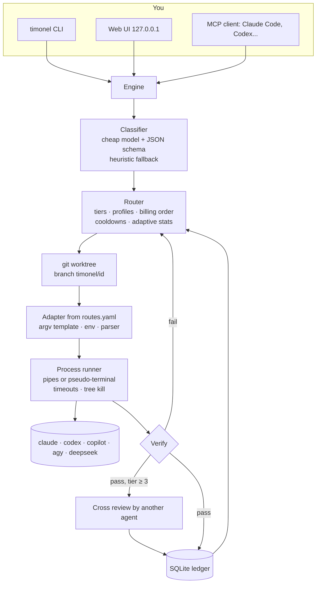
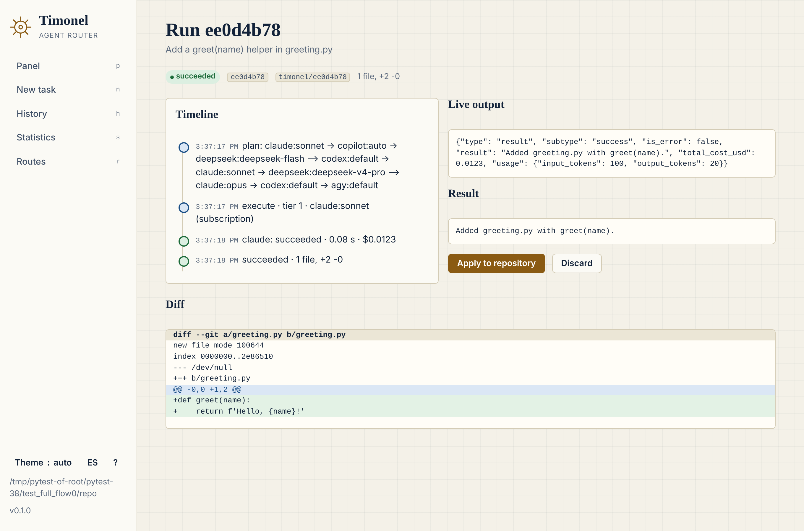
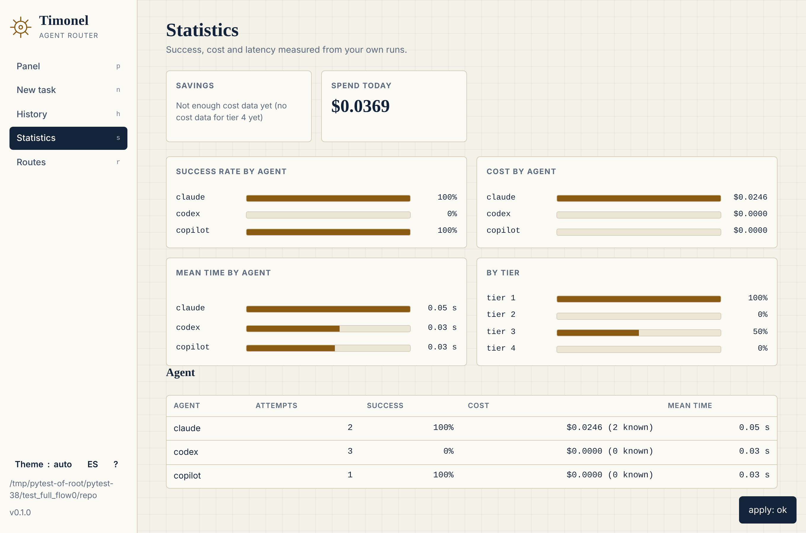
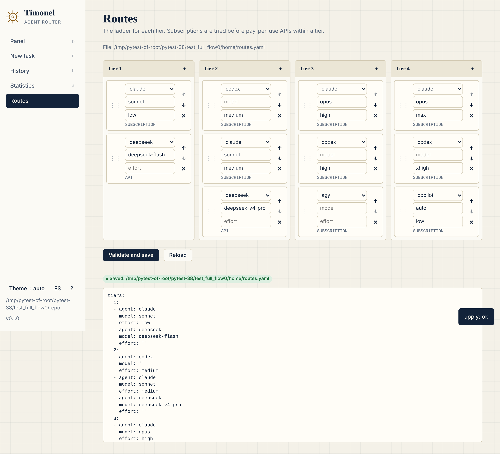
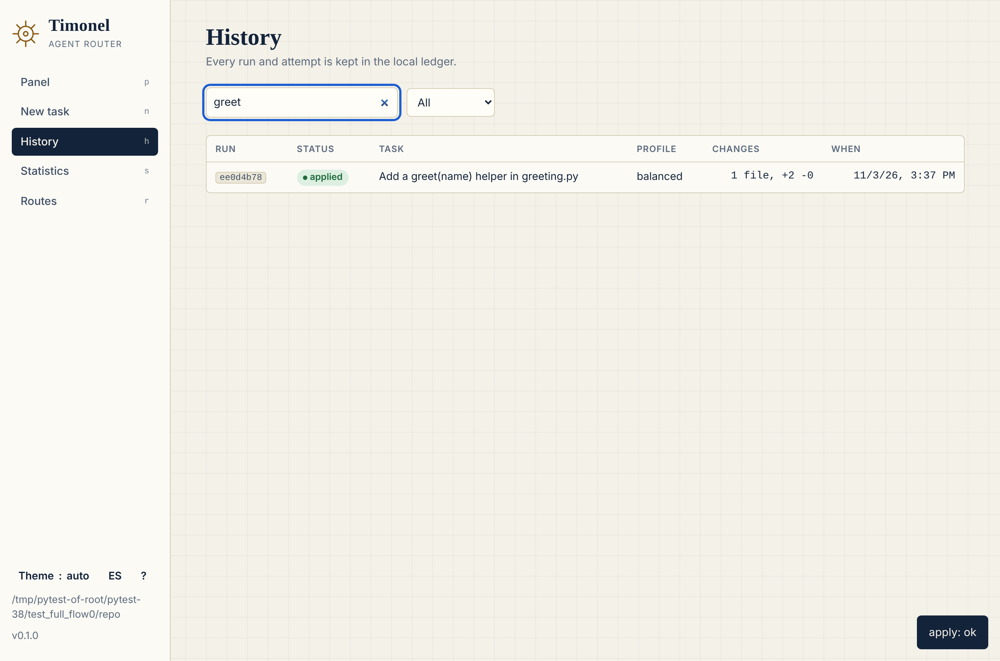
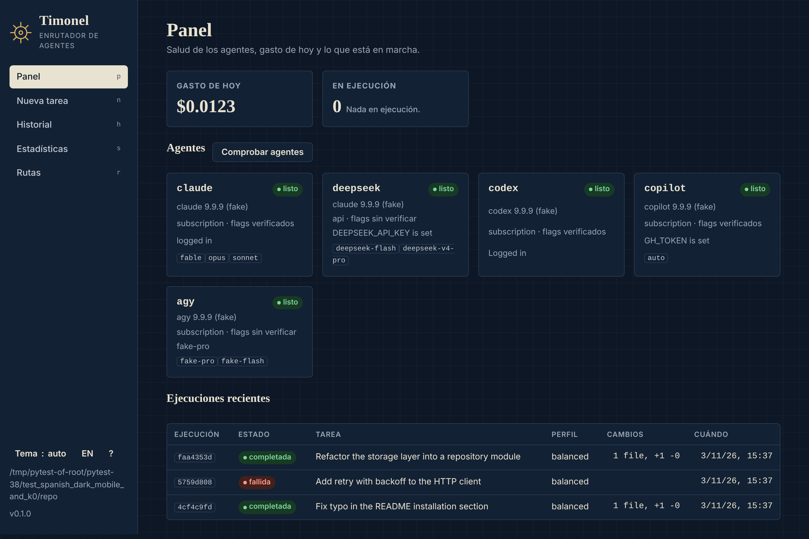

<p align="center">
  
</p>

<h1 align="center">Timonel</h1>

<p align="center">
  <b>Send each coding task to the right agent and model. Escalate only when it fails.</b><br>
  Claude Code · Codex CLI · GitHub Copilot CLI · Google Antigravity · DeepSeek
</p>

<p align="center">
  <a href="https://github.com/EduMayMar/Timonel/actions/workflows/ci.yml"></a>
  
  
  <a href="LICENSE"></a>
  
  
</p>

<p align="center"><a href="README.es.md">Leer en español</a></p>

<p align="center">
  
</p>

*Timonel* is Spanish for helmsman. You give it a task; it classifies how hard it is, picks a ladder
of agents and models, runs the cheapest suitable one in an isolated git worktree, verifies the result
with your tests and, if they fail, escalates to a stronger model with the error as context. Nothing
touches your branch until you apply it.

- **One command for every CLI agent you already pay for.** Subscriptions are tried before
  pay-per-use APIs at the same level.
- **Explains every decision.** `timonel plan` shows the classification, the route and why, without
  running anything.
- **Safe by default.** Read-only for explain/review tasks, worktrees for edits, no shell, secrets
  scoped to the one process that needs them and redacted everywhere else.
- **Declarative adapters.** Every flag lives in `routes.yaml`. When a CLI changes, you fix YAML, not
  code.
- **Learns from your ledger.** Success, cost and latency per task kind, tier and agent reorder the
  ladder, with the numbers behind each choice.
- **Local web UI.** Live timeline, diffs, one-click apply, statistics and a drag-and-drop route
  editor. English and Spanish, light and dark.

## Quick start (60 seconds)

```bash
uv tool install git+https://github.com/EduMayMar/Timonel   # or: pipx install git+https://github.com/EduMayMar/Timonel
timonel doctor            # which agents are installed and logged in
timonel init              # write routes.yaml with the agents you have
cd path/to/your/repo
timonel plan "Fix the crash when config.yaml is empty"
timonel run "Fix the crash when config.yaml is empty" --verify "python -m pytest -q"
timonel diff <id>         # review
timonel apply <id>        # merge branch timonel/<id> into your branch
timonel ui                # or do it all in the browser
```

You need at least one agent CLI installed and logged in: `claude`, `codex`, `copilot` or `agy`. For
DeepSeek, set `DEEPSEEK_API_KEY` and have `claude` installed.

## How it works



1. **Classify.** A cheap model returns `{complexity 1-4, kind, risk, needs_write, estimated_files}`.
   The answer must match a schema; otherwise deterministic heuristics decide.
2. **Route.** The starting tier is the complexity, adjusted by risk and profile. Each tier is an
   ordered ladder of `(agent, model, effort)`; subscriptions go first.
3. **Run.** Edits run in `git worktree` on `timonel/<id>`; explanations and reviews run read-only in
   place.
4. **Verify and escalate.** Your commands decide. A failure moves to the next tier with the trimmed
   error. Crashes, timeouts, garbage output and usage limits move to the next rung of the same tier,
   and usage limits put the agent in cooldown.
5. **Review.** From tier 3, a different agent reviews the diff; a rejection gets one fix round.
6. **Record.** Every attempt, its cost (real when the CLI reports it, estimated otherwise) and its
   outcome go to the ledger, which feeds `stats`, savings and adaptive routing.

Read more in [docs/concepts.md](docs/concepts.md).

## Agents

| Agent | How it is called | Flags | Billing default |
|---|---|---|---|
| Claude Code | `claude -p`, JSON output, prompt on stdin | verified with `--help` of 2.1.317 | subscription |
| Codex CLI | `codex exec --json`, prompt on stdin | verified with `--help` of 0.166.0 (effort key unverified) | subscription |
| GitHub Copilot CLI | `copilot -p --silent --allow-all-tools --deny-tool=shell` | verified with `--help` of 1.0.105 | subscription |
| Google Antigravity | `agy -p` inside a pseudo-terminal | **unverified** (from public issues and cheat sheets) | subscription |
| DeepSeek | Claude Code with `ANTHROPIC_BASE_URL=https://api.deepseek.com/anthropic` | Claude flags verified, endpoint unverified | api |

Run `timonel doctor --smoke` on your machine: it sends one tiny read-only prompt to each agent and
tells you whether the flags work. Details and sources in [docs/agents.md](docs/agents.md).

## Profiles

| Profile | Starts at | Escalates up to | Use it for |
|---|---|---|---|
| `cheap` | complexity − 1 | tier 3, once | Bulk chores where cost matters most |
| `balanced` (default) | complexity | 2 more tiers | Everyday work |
| `max` | tier 4 | tier 4 | When it has to be right the first time |

Profiles are plain data in `routes.yaml`; add your own.

## Commands

| Command | What it does |
|---|---|
| `timonel doctor [--smoke] [--json]` | Installed agents, versions, login, models; `--smoke` validates flags with a real prompt |
| `timonel models [agent]` | Models per agent (`agy models` and each CLI's known aliases) |
| `timonel plan "task"` | Classification, route and reasons, without running (`--model-classify` asks the classifier model) |
| `timonel run "task"` | Run with `--profile`, `--force agent[:model]`, `--verify CMD` (repeatable), `--race`, `--decompose` |
| `timonel status [id]` · `diff id` | Runs, attempts, costs, diff |
| `timonel apply id` · `discard id` | Merge or delete a run's branch and worktree |
| `timonel resume id` | Continue an interrupted run |
| `timonel stats` | Success, cost and latency by agent, tier and task kind; savings vs. always using the top tier |
| `timonel init` · `validate` | Generate or check `routes.yaml` |
| `timonel ui` | Local web interface |
| `timonel mcp` | MCP server over stdio with `timonel_plan`, `timonel_run`, `timonel_status` |

### Use Timonel from another agent (MCP)

```bash
claude mcp add timonel -- timonel mcp
codex mcp add timonel -- timonel mcp
```

The MCP server can plan and start runs and report their status, only in the repository where it was
started; merging stays a human decision.

## Web UI

`timonel ui` prints a single-use URL on `127.0.0.1`. The token is exchanged for a strict cookie, every request
checks `Host`, state changes require same `Origin` plus a CSRF token, and a nonce-based CSP blocks
injected scripts.

| Panel | Live run |
|---|---|
|  |  |
| **Statistics** | **Routes editor** |
|  |  |
| **History** | **Spanish, dark mode** |
|  |  |

Keyboard: `p` panel, `n` new task, `h` history, `s` statistics, `r` routes, `t` theme, `l` language,
`?` help, `Ctrl+Enter` preview/launch. The screenshots were taken by the Playwright test suite against
fake agents.

## Configuration

Your `routes.yaml` lives in `~/.config/timonel/` (Linux, macOS) or `%APPDATA%\timonel\` (Windows) and
is merged over the [built-in defaults](src/timonel/default_routes.yaml). It is never read from the
repository being changed. Full reference: [docs/routes-reference.md](docs/routes-reference.md).

```yaml
execution:
  verify:
    - ["python", "-m", "pytest", "-q"]
agents:
  codex:
    billing: api
  claude:
    cost_per_attempt_usd: 0.05
```

Keys go in environment variables (`DEEPSEEK_API_KEY`, `GH_TOKEN`...) or in the OS keyring under the
service `timonel` (`pip install "timonel[keyring]"`), never in files.

## FAQ

**Does Timonel call any model API itself?** No. It only runs the CLIs you installed, with their own
logins.

**Will it touch my working copy?** Not until you run `timonel apply`. Edits happen in a worktree under
Timonel's data directory.

**How does it know the cost?** Claude Code reports `total_cost_usd` in its JSON output (the vendor
calls it a client-side estimate). For other agents Timonel estimates from your
`cost_per_attempt_usd` or from previous reported costs, and marks the value as estimated.

**What if a CLI changes its flags?** Override the adapter in your `routes.yaml`, run
`timonel validate` and `timonel doctor --smoke`. No code changes or releases needed.

**Can I use only one agent?** Yes. `timonel init` keeps only the agents it finds; with one agent you
still get worktrees, verification, retries across models and the ledger.

**Is the savings number real?** It compares what your successful runs cost with the mean reported cost
of top-tier attempts in your own ledger. Until there is data for both, it says "n/a".

**Are my tests safe to run on agent changes?** Verification runs your project's tests, which the agent
may have edited, outside the agent's sandbox. Timonel strips API keys and tokens from their
environment, but only use it on repositories you would run tests for anyway. See
[docs/security.md](docs/security.md).

**Is automating my subscription allowed?** Check each plan's terms first. See
[docs/limits-and-terms.md](docs/limits-and-terms.md).

## Troubleshooting

**`timonel doctor` says an agent is not installed.** The command must be on `PATH` for the shell that
starts Timonel. On Windows, npm installs `claude.cmd`, `codex.cmd` and `copilot.cmd`; Timonel resolves
those shims to `node script.js` automatically. For safety, on Windows only executables in `PATH`
folders are accepted, never from the current directory. If you installed a native binary elsewhere, set
`agents.<name>.command` to its full path.

**Windows: "refusing to pass arguments with cmd.exe metacharacters".** The agent is a batch-file shim
that is not an npm shim, and its prompt is passed as an argument. Set `prompt_via: stdin` (with an
empty `prompt_args`) if the CLI supports it, or point `command` to a real `.exe`.

**`agy` hangs or prints nothing.** `agy -p` is known to hang when it does not see a terminal
(antigravity-cli issue #318). Timonel runs it in a pseudo-terminal: `pty` on macOS and Linux and
ConPTY through `pywinpty` on Windows (installed automatically on Windows). If `doctor` warns that
`pywinpty` is missing, run `pip install pywinpty`. If it still hangs, lower `--print-timeout` in
`base_args` and report the version in an issue.

**Windows: Unicode or line endings look wrong.** Timonel reads all output as UTF-8 with replacement
and normalizes CRLF. If an agent writes in another code page, set `PYTHONUTF8=1` or configure the CLI
to emit UTF-8.

**`--permission-prompts` is rejected by `claude`.** It needs Claude Code 2.1.259 or later. Update
Claude Code or remove the flag from `agents.claude.base_args`.

**An agent is skipped with "cooling down".** It hit a usage limit and rests for
`execution.cooldown_minutes` (30 by default). The UI panel marks it; lower the value in `routes.yaml`
if your plan resets sooner.

**`apply` says the repository has uncommitted changes.** Commit or stash first; Timonel never merges
into a dirty working tree.

## Development

```bash
uv sync --group dev
uv run pytest -q                    # unit, integration, property-based and browser tests
uv run ruff check src tests && uv run mypy
```

The engine is tested against fake agent CLIs (`tests/fakes/fake_agent.py`) that simulate success,
failing tests, usage limits, hangs, garbage, partial output and invalid JSON, on Windows, macOS and
Linux. See [CONTRIBUTING.md](CONTRIBUTING.md), [SECURITY.md](SECURITY.md) and
[CHANGELOG.md](CHANGELOG.md).

## License

[MIT](LICENSE)
