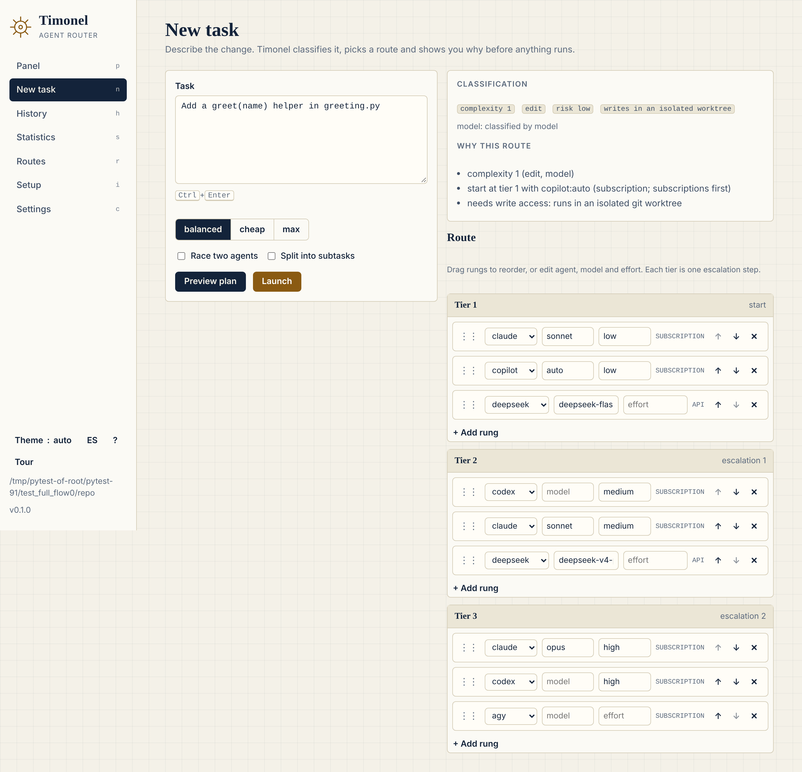
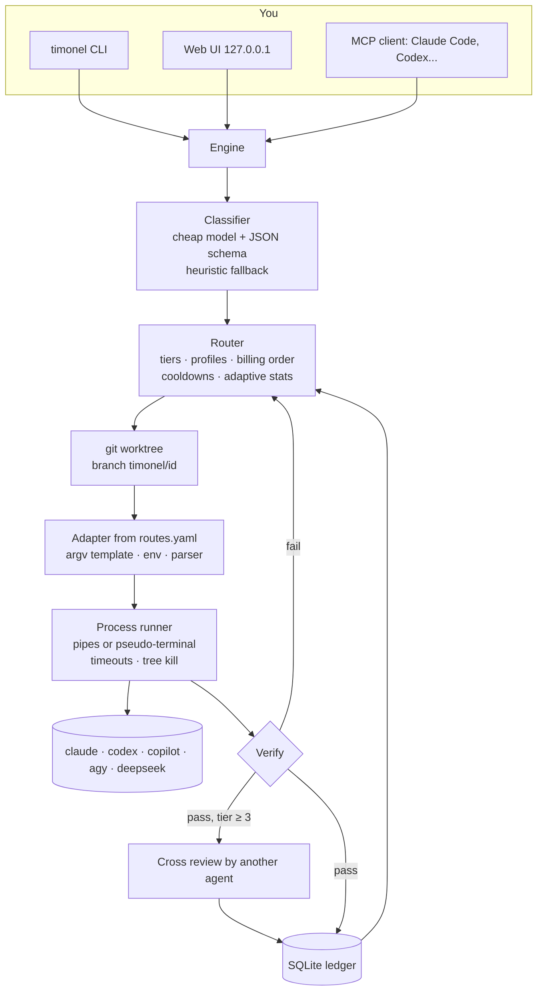
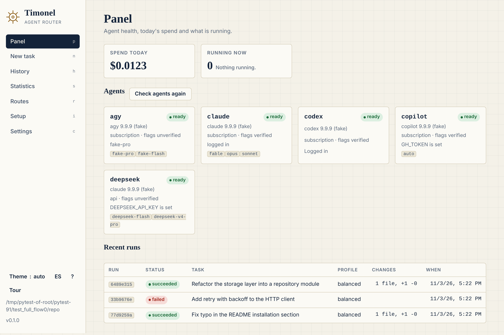

<p align="center">
  
</p>

<h1 align="center">Timonel</h1>

<p align="center">
  <b>Send each coding task to the right agent and model. Escalate only when it fails.</b><br>
  Claude Code · Codex · GitHub Copilot · Gemini CLI · Qwen Code · OpenCode · Aider · and more
</p>

<p align="center">
  <a href="https://github.com/EduMayMar/Timonel/actions/workflows/ci.yml"></a>
  
  
  <a href="LICENSE"></a>
  
  
</p>

<p align="center"><a href="README.es.md">Leer en español</a></p>

<p align="center">
  
</p>

*Timonel* is Spanish for helmsman. You give it a task; it classifies how hard it is, picks a ladder
of agents and models, runs the cheapest suitable one in an isolated git worktree, verifies the result
with your tests and, if they fail, escalates to a stronger model with the error as context. Nothing
touches your branch until you apply it.

- **One command for every CLI agent you already pay for.** 16 agent connectors and 11 model APIs,
  each with the date and version its flags were checked. Subscriptions are tried before pay-per-use
  APIs at the same level.
- **Made for beginners too.** `timonel start` installs and explains each piece, `timonel demo` shows
  the whole flow with simulated agents, `timonel learn` explains the concepts, and every error has a
  `TMN-xxxx` code with the fix.
- **Private and safe by default.** Timonel never asks for, sees or stores your account passwords or
  tokens; API keys go to the system keyring. No telemetry. Edits happen in worktrees, no shell,
  secrets are scoped to one process and redacted everywhere else.
- **Explains every decision.** `timonel plan` shows the classification, the route and why, without
  running anything; `--explain` works on any command.
- **Everything is configurable.** One JSON Schema drives validation, `timonel config`, the docs and
  the settings page. Layers: defaults, user, trusted project, environment, `--set`.
- **Local web UI.** Guided tour, setup checklist, settings built from the schema, live timeline,
  diffs, one-click apply, statistics and a route editor. English, Spanish and Portuguese, light and
  dark, keyboard and screen-reader friendly.

## Quick start (60 seconds)

```bash
pipx install git+https://github.com/EduMayMar/Timonel   # or: uv tool install git+https://github.com/EduMayMar/Timonel
timonel demo              # see the whole flow with simulated agents, nothing installed
timonel start             # guided setup: Git, Node.js and the agents you choose, explained step by step
cd path/to/your/repo
timonel plan "Fix the crash when config.yaml is empty"
timonel run "Fix the crash when config.yaml is empty"
timonel diff <id>         # review
timonel apply <id>        # merge branch timonel/<id> into your branch
timonel ui                # or do it all in the browser
```

Installers that show what they will do before doing it: [`install/install.sh`](install/install.sh)
and [`install/install.ps1`](install/install.ps1). Single-file binaries for Windows, macOS and Linux,
and a container image, are attached to each release. Step-by-step guides for
[Windows](docs/install/windows.md), [macOS](docs/install/macos.md) and [Linux](docs/install/linux.md).

## How it works



1. **Classify.** A cheap model returns `{complexity 1-4, kind, risk, needs_write, estimated_files}`.
   The answer must match a schema; otherwise deterministic heuristics decide.
2. **Route.** The starting tier is the complexity, adjusted by risk and profile. Each tier is an
   ordered ladder of `(agent, model, effort)`; subscriptions go first.
3. **Run.** Edits run in `git worktree` on `timonel/<id>`; explanations and reviews run read-only in
   place.
4. **Verify and escalate.** Your commands decide. A failure moves to the next tier with the trimmed
   error. Crashes, timeouts, garbage output and usage limits move to the next rung of the same tier,
   and usage limits put the agent in cooldown.
5. **Review.** From tier 3, a different agent reviews the diff; a rejection gets one fix round.
6. **Record.** Every attempt, its cost (real when the CLI reports it, estimated otherwise) and its
   outcome go to the ledger, which feeds `stats`, savings and adaptive routing.

Read more in [docs/concepts.md](docs/concepts.md).

## Agents

Agents (coding CLIs that edit files in a worktree): Claude Code, Codex CLI, GitHub Copilot CLI,
Gemini CLI, Qwen Code, OpenCode, Amp, Crush, Cline, Factory Droid, Kimi Code, Aider and DeepSeek
through Claude Code have flags verified against their own `--help`; Cursor CLI is documented only;
Google Antigravity and Goose are community entries, not verified.

Providers (HTTP model APIs used to classify, plan and review, never to edit): OpenAI, Anthropic,
Gemini API, OpenRouter, Ollama, LM Studio, Groq, Mistral, Together, Fireworks and the DeepSeek API.

New connectors start disabled: `timonel agents list`, `timonel agents enable <name>`,
`timonel agents test <name>`. The full table with versions and check dates is
[docs/connectors.md](docs/connectors.md); adding one is a YAML file
([docs/adding-an-agent.md](docs/adding-an-agent.md)). A nightly workflow re-reads each CLI's `--help`
and opens an issue when a flag disappears.

## Profiles

| Profile | Starts at | Escalates up to | Use it for |
|---|---|---|---|
| `cheap` | complexity − 1 | tier 3, once | Bulk chores where cost matters most |
| `balanced` (default) | complexity | 2 more tiers | Everyday work |
| `max` | tier 4 | tier 4 | When it has to be right the first time |

Profiles are plain configuration data; add your own with `timonel profiles create`.

## Commands

| Command | What it does |
|---|---|
| `timonel start [--dry-run] [--agents a,b]` | Guided installation and login check, step by step |
| `timonel demo` · `learn [topic]` | Simulated end-to-end run · plain-language explanations |
| `timonel doctor [--smoke] [--fix]` | Installed agents, versions, login, models; `--fix` offers the fix for each problem |
| `timonel plan "task"` | Classification, route and reasons, without running |
| `timonel run "task"` | Run with `--profile`, `--force agent[:model]`, `--verify CMD`, `--race`, `--decompose` |
| `timonel status [id]` · `diff id` · `apply id` · `discard id` · `resume id` | Follow, review, keep or drop a run |
| `timonel stats` | Success, cost and latency by agent, tier and task kind; savings vs. always using the top tier |
| `timonel agents list\|info\|enable\|disable\|test\|add\|remove` | Manage connectors |
| `timonel config list\|get\|set\|unset\|explain\|edit\|validate\|export\|import\|reset\|schema` | Every option, with its layer and meaning |
| `timonel profiles` · `mode simple\|expert` · `trust` · `keys` · `purge` | Profiles, progressive disclosure, project trust, keyring, retention |
| `timonel ui` · `mcp` | Local web interface · MCP server over stdio |

Add `--explain` to any command to see what it will do, `--lang es|en|pt` to change the language and
`--set key=value` to override one option.

### Use Timonel from another agent (MCP)

```bash
claude mcp add timonel -- timonel mcp
codex mcp add timonel -- timonel mcp
```

The MCP server can plan and start runs and report their status, only in the repository where it was
started; merging stays a human decision.

## Web UI

`timonel ui` prints a single-use URL on `127.0.0.1`. The token is exchanged for a strict cookie, every request
checks `Host`, state changes require same `Origin` plus a CSRF token, and a nonce-based CSP blocks
injected scripts.

| Guided tour | Setup checklist |
|---|---|
|  |  |
| **Settings from the schema** | **Live run** |
|  |  |
| **Panel** | **Routes editor** |
|  |  |

Keyboard: `p` panel, `n` new task, `h` history, `s` statistics, `r` routes, `i` setup, `c` settings,
`t` theme, `l` language, `?` help (all configurable under `ui.shortcuts`). The screenshots were taken
by the Playwright test suite against fake agents.

## Configuration

Values come from built-in defaults, then your user file (`~/.config/timonel/routes.yaml` or
`%APPDATA%\timonel\routes.yaml`), then a repository's `.timonel.yaml` **only after `timonel trust`**,
then `TIMONEL_SECTION__KEY` environment variables, then `--set key=value`.

```bash
timonel config explain review.enabled      # meaning, default, value and which layer set it
timonel config set verification.commands '[["python", "-m", "pytest", "-q"]]'
```

Guides: [configuration](docs/configuration.md), [recipes](docs/recipes.md) (spend the minimum,
maximum quality, only Copilot) and the generated reference in
[English](docs/reference/configuration.md), [Spanish](docs/reference/configuration.es.md) and
[Portuguese](docs/reference/configuration.pt.md). API keys go to the system keyring with
`timonel keys set NAME` (`pip install "timonel[keyring]"`) or environment variables, never in files.

## FAQ

**Does Timonel call any model API itself?** Only providers you configure (for example to classify
or review). Otherwise it runs the CLIs you installed, with their own logins. It sends no telemetry.

**Will it touch my working copy?** Not until you run `timonel apply`. Edits happen in a worktree under
Timonel's data directory.

**How does it know the cost?** Claude Code reports `total_cost_usd` in its JSON output (the vendor
calls it a client-side estimate). For other agents Timonel estimates from your
`cost_per_attempt_usd` or from previous reported costs, and marks the value as estimated.

**What if a CLI changes its flags?** Override the adapter in your `routes.yaml`, run
`timonel validate` and `timonel doctor --smoke`. No code changes or releases needed.

**Can I use only one agent?** Yes. `timonel init` keeps only the agents it finds; with one agent you
still get worktrees, verification, retries across models and the ledger.

**Is the savings number real?** It compares what your successful runs cost with the mean reported cost
of top-tier attempts in your own ledger. Until there is data for both, it says "n/a".

**Are my tests safe to run on agent changes?** Verification runs your project's tests, which the agent
may have edited, outside the agent's sandbox. Timonel strips API keys and tokens from their
environment, but only use it on repositories you would run tests for anyway. See
[docs/security.md](docs/security.md).

**Is automating my subscription allowed?** Check each plan's terms first. See
[docs/limits-and-terms.md](docs/limits-and-terms.md).

## Troubleshooting

**`timonel doctor` says an agent is not installed.** The command must be on `PATH` for the shell that
starts Timonel. On Windows, npm installs `claude.cmd`, `codex.cmd` and `copilot.cmd`; Timonel resolves
those shims to `node script.js` automatically. For safety, on Windows only executables in `PATH`
folders are accepted, never from the current directory. If you installed a native binary elsewhere, set
`agents.<name>.command` to its full path.

**Windows: "refusing to pass arguments with cmd.exe metacharacters".** The agent is a batch-file shim
that is not an npm shim, and its prompt is passed as an argument. Set `prompt_via: stdin` (with an
empty `prompt_args`) if the CLI supports it, or point `command` to a real `.exe`.

**`agy` hangs or prints nothing.** `agy -p` is known to hang when it does not see a terminal
(antigravity-cli issue #318). Timonel runs it in a pseudo-terminal: `pty` on macOS and Linux and
ConPTY through `pywinpty` on Windows (installed automatically on Windows). If `doctor` warns that
`pywinpty` is missing, run `pip install pywinpty`. If it still hangs, lower `--print-timeout` in
`base_args` and report the version in an issue.

**Windows: Unicode or line endings look wrong.** Timonel reads all output as UTF-8 with replacement
and normalizes CRLF. If an agent writes in another code page, set `PYTHONUTF8=1` or configure the CLI
to emit UTF-8.

**`--permission-prompts` is rejected by `claude`.** It needs Claude Code 2.1.259 or later. Update
Claude Code or remove the flag from `agents.claude.base_args`.

**An agent is skipped with "cooling down".** It hit a usage limit and rests for
`escalation.cooldown_minutes` (30 by default). The UI panel marks it; lower the value with `timonel config set`
if your plan resets sooner.

**`apply` says the repository has uncommitted changes.** Commit or stash first; Timonel never merges
into a dirty working tree.

## Development

```bash
uv sync --group dev
uv run pytest -q                    # unit, integration, property-based and browser tests
uv run ruff check src tests && uv run mypy
```

The engine is tested against fake agent CLIs (`tests/fakes/fake_agent.py`) that simulate success,
failing tests, usage limits, hangs, garbage, partial output and invalid JSON, on Windows, macOS and
Linux. See [CONTRIBUTING.md](CONTRIBUTING.md), [SECURITY.md](SECURITY.md) and
[CHANGELOG.md](CHANGELOG.md).

## License

[MIT](LICENSE)
