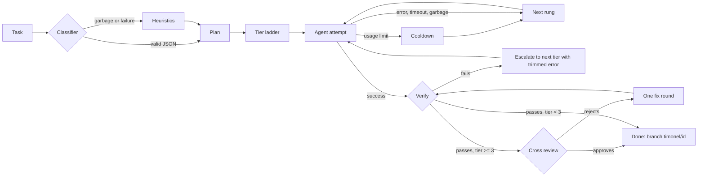

# Concepts

## The loop



## Classification

A cheap model receives the task between `<task>` tags, is told the task is data, and must answer with
one JSON object:

```json
{"complexity": 1, "kind": "edit", "risk": "low", "needs_write": true, "estimated_files": 1}
```

`complexity` is 1 to 4, `kind` is one of `explain`, `edit`, `debug`, `refactor`, `architecture`,
`review`, `risk` is `low`, `medium` or `high`. The answer is validated against that schema. If the
model is unavailable, fails, or returns anything that does not validate, deterministic heuristics
decide instead: keywords in English and Spanish for the kind, length, number of files mentioned,
breadth words ("entire", "todo el") and trivial words ("typo"). `explain` and `review` never get write
access, whatever the model says.

The classifier ladder is the `classifier:` list in `routes.yaml`: the first usable rung answers.

## Tiers and ladders

`tiers:` maps 1 to 4 to an ordered list of rungs `{agent, model, effort}`. A plan starts at the tier
equal to the complexity (one higher for high-risk tasks below tier 3), shifted by the profile, and
adds one more tier per allowed escalation.

Within a tier, rungs of agents with `billing: subscription` always come before `billing: api`. Inside
each billing group the configured order is kept, unless adaptive routing has enough data to reorder.

What moves you to the **next rung of the same tier**: the agent crashed, timed out, produced output
that cannot be parsed, hit a usage limit, or finished without changing files on an edit task.

What moves you to the **next tier**: the change failed verification. The next agent receives the
last lines of the failing command's output as context, and the worktree is reset first.

## Profiles

| Profile | Effect |
|---|---|
| `cheap` | Starts one tier lower, never goes above tier 3, at most one escalation. |
| `balanced` | Starts at the complexity, up to `execution.max_escalations` escalations. |
| `max` | Starts at the top tier. |

Profiles are data in `routes.yaml` (`start_offset`, `min_tier`, `max_tier`, `skip_tiers`,
`max_escalations`), so you can add your own.

## Worktrees and permissions

Edit tasks run in `git worktree add -b timonel/<id>` under Timonel's data directory, never in your
working copy. After a successful attempt Timonel commits the changes on that branch, checks that no
path escapes the repository and that no symlink points outside it, then verifies. Nothing reaches your
branch until you run `timonel apply <id>` (a `--no-ff` merge that refuses a dirty working tree) or
press *Apply* in the UI. `timonel discard <id>` removes the worktree and the branch.

`explain` and `review` tasks run in place with each agent's read-only arguments (`--permission-mode
plan`, `--sandbox read-only`, `--deny-tool=write`, `--mode plan`).

## Verification

`execution.verify` in `routes.yaml`, or one or more `--verify "command"` on the command line, lists
the commands that must exit with 0. They run inside the worktree with a minimal environment (no API
keys or tokens; add names with `execution.verify_env`). Verification commands are never read from
the repository being changed, but the tests they run are code the agent may have edited.

## Cross review

From `execution.review_min_tier` (3 by default), a different agent reviews the diff in read-only mode
and answers `{"approve": bool, "issues": [...]}`. A rejection gives the executor one round to fix
the issues; the result must pass verification again. If no reviewer is available, or its answer is
not valid JSON, the change is kept and the timeline says so.

## Usage limits and cooldowns

When an attempt fails and its output matches a usage-limit pattern (global `rate_limit_patterns` plus
the agent's own), the agent is put in cooldown for `execution.cooldown_minutes`. Cooldowns live in
the ledger, so they survive restarts and also affect planning.

## Timeouts, cancellation and resume

Each attempt has a total timeout and an idle timeout (no output). When either fires, or you cancel,
Timonel kills the whole process tree: a new session and `killpg` on macOS and Linux, a new process
group and `taskkill /T /F` on Windows. If you press Ctrl+C, the run is marked `interrupted`;
`timonel resume <id>` continues from the rung that was running.

## Adaptive routing

With `adaptive.enabled`, attempts in the ledger are grouped by (kind, tier, agent, model). Once a
group has `min_samples` attempts, its Laplace-smoothed success rate reorders rungs within the same
billing group, and the plan explains it, for example:
`tier 3: chose codex:default because its success rate in refactor is 82% (n=11) vs claude:opus 56% (n=9)`.

## Race mode

`--race` runs the first two distinct agents of the starting tier at the same time, in separate
worktrees. Runs that pass verification compete on diff size (smaller wins), then on time. The loser is
discarded; the winner becomes the run's branch.

## Decomposition

`--decompose` (or `decompose.auto` for complexity 4) asks the planner ladder for
`{"subtasks": [{"id", "task", "depends_on"}]}`. The plan is validated (2 to `max_subtasks` items,
unique ids, known dependencies, no cycles). Subtasks run in waves: those without pending dependencies
run in parallel, each in its own worktree branched from the integration branch, and successful ones
are merged back before the next wave. Subtasks that depend on a failed one are skipped. The
integrated result is verified once more at the end.

## Cost and savings

If the CLI reports a cost (`total_cost_usd` in Claude Code's JSON), it is stored as real. Otherwise
Timonel stores an estimate: the agent's `cost_per_attempt_usd` if you set one, or the mean reported
cost of that agent and model in your ledger. Estimates are marked with `~` in the CLI and "est." in
the UI.

Savings compare what successful runs actually cost with what they would have cost at the top tier:
the mean reported cost of top-tier attempts in your ledger, or `cost_per_attempt_usd` of a top-tier
agent. Until such data exists, savings are shown as "n/a" rather than invented.

## The ledger

Every run, attempt, cooldown and event is stored in SQLite at `<data dir>/ledger.sqlite`
(`~/.local/share/timonel` on Linux, `%LOCALAPPDATA%\timonel` on Windows, overridable with
`TIMONEL_HOME`). Outputs and errors are redacted before they are written.
