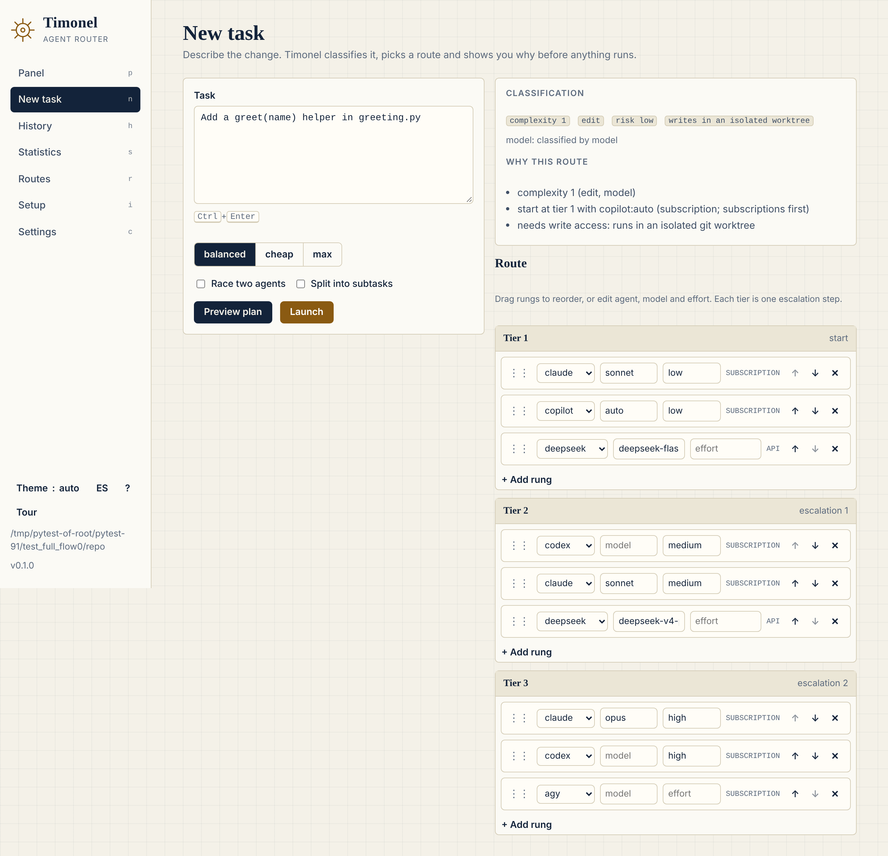

# Timonel

**Send each coding task to the right agent and model. Escalate only when it fails.**

*Timonel* is Spanish for helmsman. You describe a task; Timonel works out how hard it is, picks the
cheapest suitable coding agent you already have (Claude Code, Codex, GitHub Copilot, Gemini CLI and
more), runs it in an isolated copy of your repository, checks the result with your tests and, if they
fail, hands the task to a stronger model with the error as context. Your branch is untouched until you
apply the result.

## Start here

- New to all this? Follow the [quick start](quickstart.md) ([en español](quickstart.es.md)). It takes
  a few minutes and explains every step.
- Want to see it first, without installing any agent? Run `timonel demo`.
- Already use coding agents? Read [concepts](concepts.md) and the [recipes](recipes.md).

## What it promises

- It never asks for, sees or stores your account passwords or tokens. Logins happen in each vendor's
  official tool.
- No telemetry, ever. See [security and privacy](security.md).
- Every option can be changed, and every option is explained: [configuration](configuration.md).
- Windows, macOS and Linux are all first-class.
