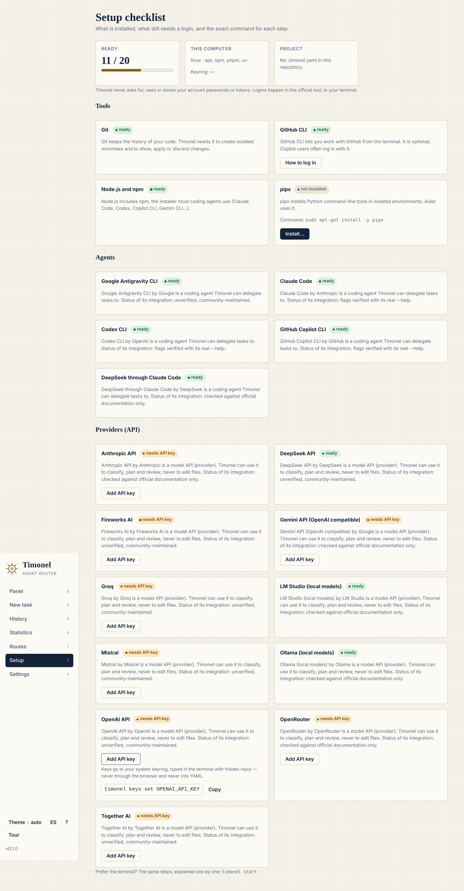

# Quick start

This guide assumes nothing. If a word is new, `timonel learn` explains it (for example
`timonel learn worktree`).

## 1. Install Timonel

You need Python 3.11 or newer. Then, in a terminal:

=== "Windows (PowerShell)"

    ```powershell
    Invoke-WebRequest https://raw.githubusercontent.com/EduMayMar/Timonel/main/install/install.ps1 -OutFile install.ps1
    Get-Content install.ps1   # read it first
    powershell -ExecutionPolicy Bypass -File install.ps1
    ```

=== "macOS / Linux"

    ```bash
    curl -fsSL https://raw.githubusercontent.com/EduMayMar/Timonel/main/install/install.sh -o install.sh
    less install.sh           # read it first
    sh install.sh
    ```

=== "With pipx or uv"

    ```bash
    pipx install git+https://github.com/EduMayMar/Timonel
    # or
    uv tool install git+https://github.com/EduMayMar/Timonel
    ```

The script shows the one command it will run (`uv tool install` or `pipx install`) and asks before
running it. It never asks for administrator rights. Until the first PyPI release, set
`TIMONEL_SOURCE=git+https://github.com/EduMayMar/Timonel` before running it.

To store API keys in the system keyring, install the extra: `pipx install ".[keyring]"` from a
checkout (or `pipx install "timonel[keyring]"` once it is on PyPI).

The per-OS guides have more detail: [Windows](install/windows.md), [macOS](install/macos.md),
[Linux](install/linux.md).

## 2. Try the demo

```bash
timonel demo
```

It creates a small project with a bug and two simulated agents. You will see the cheap agent fail the
tests, Timonel escalate to the stronger one, and the tests pass. Nothing is installed and no AI is
called.

## 3. Set up your agents

```bash
timonel start
```

The assistant checks your system (Git, Node.js, package managers) and the coding agents you choose.
For each missing piece it explains what it is, shows the exact command and its approximate size, and
asks: **install**, **skip**, **explain** or **quit**. Add `--dry-run` to only see the plan.

When an agent needs a login, Timonel starts the vendor's official login in your terminal. Your
password goes to the vendor, never to Timonel. API keys, if you use any, are typed with hidden input
and stored in your system keyring.

Students: the [GitHub Student Developer Pack](https://education.github.com/pack) includes GitHub
Copilot; `timonel start` points you to it when you choose Copilot.

## 4. Run your first task

```bash
cd path/to/your/project
timonel plan "Fix the crash when config.yaml is empty"
timonel run "Fix the crash when config.yaml is empty"
```

`plan` only explains what would happen. `run` does the work in a separate branch and prints its id.
Then:

```bash
timonel diff <id>      # look at the change
timonel apply <id>     # keep it
timonel discard <id>   # or throw it away
```

## 5. Prefer a browser?

```bash
timonel ui
```

opens a local page with a guided tour, a setup checklist, live progress and a settings page.



## When something goes wrong

Every error has a code like `TMN-2001` with the cause, the fix and a link to
[the error list](errors.md). `timonel doctor --fix` checks everything and offers fixes. Add
`--explain` to any command to see what it will do before it does it.
