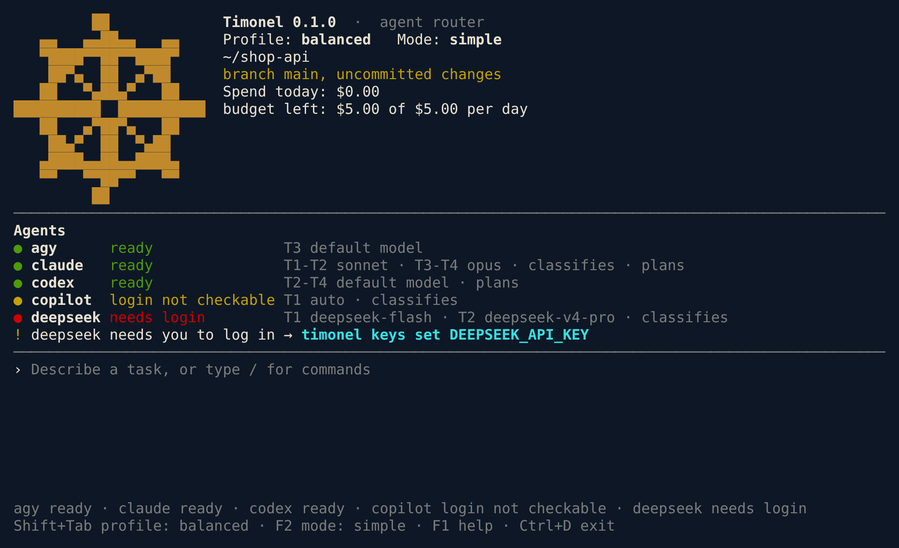
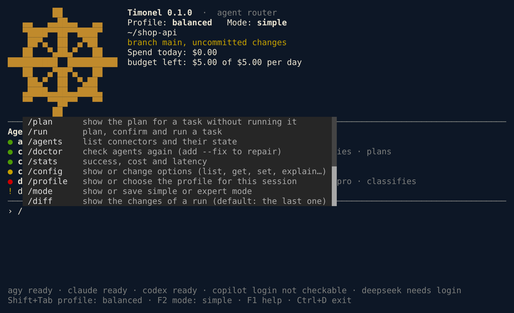
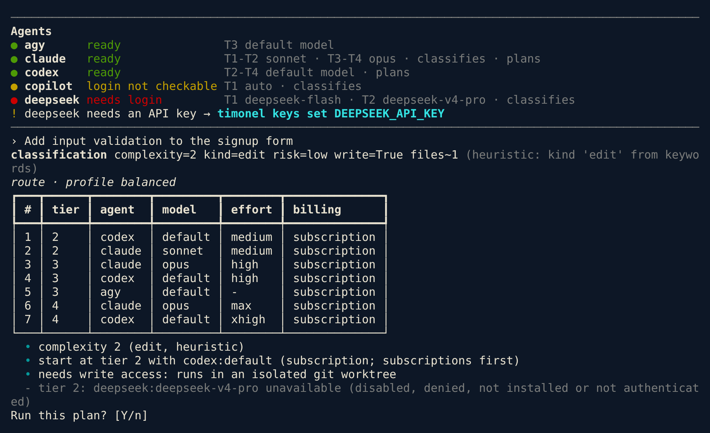
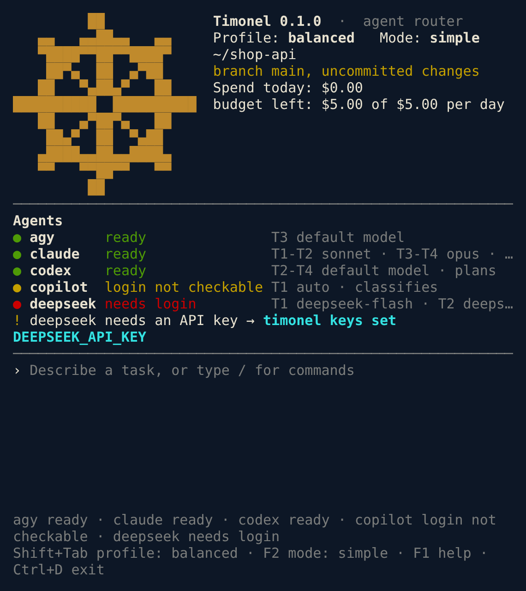
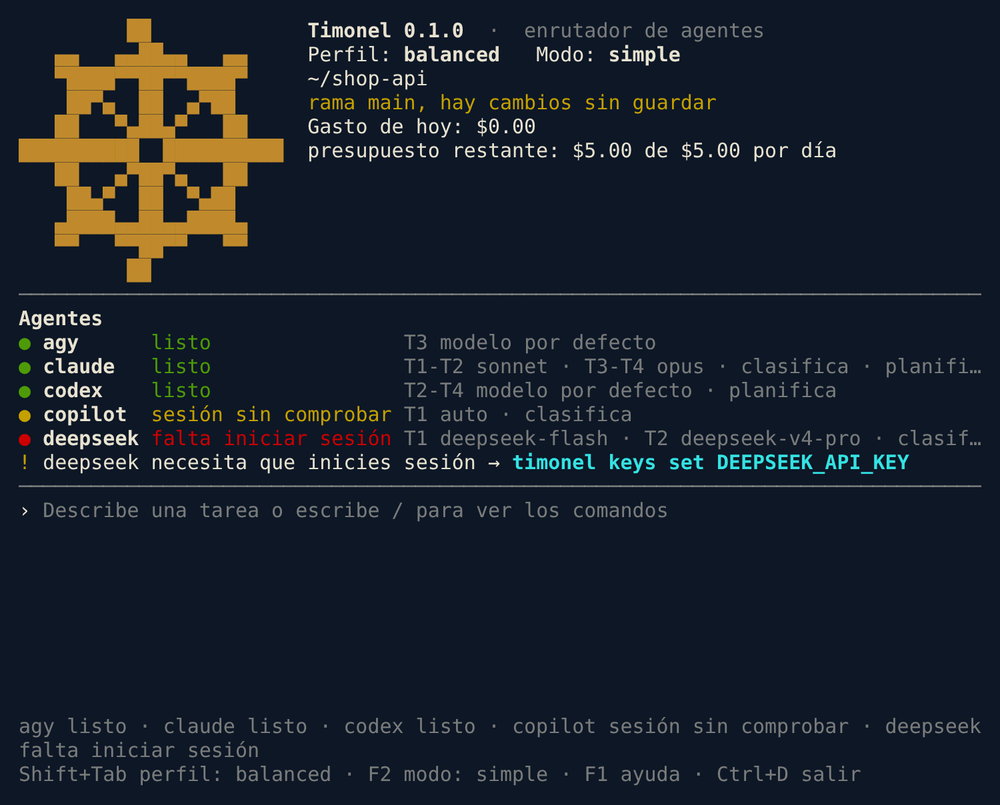

# The terminal home screen

Run `timonel` with no arguments in a terminal and the home screen opens:

- **Header**: the Timonel wheel, version, active profile (`cheap`, `balanced`, `max`), simple or
  expert mode, the current folder and its git state (branch, uncommitted changes, or "not a git
  repository"), today's spend and the budget left if you set one.
- **Agents**: one line per agent with a colored dot **and** a word (ready, needs login, login not
  checkable, not installed, checking..., no answer), plus the tiers and models it covers. The screen
  appears at once; agent checks run in the background with a time limit (`tui.check_timeout_s`) and
  are cached for `tui.status_cache_s` seconds.
- **Notices**: one line each, always ending with the exact command that fixes it (`timonel start`,
  `timonel trust`, `codex login`, `timonel keys set NAME`, an update command, `/git-init`).
- **Input box**: type a task in your own words and press Enter. Timonel shows the plan
  (classification, route and reasons), asks, then runs it with a live timeline. Ctrl+C cancels the
  run cleanly. History is kept between sessions, except lines that look like secrets.
- **Footer**: agent states and the shortcuts: Shift+Tab cycles the profile, F2 toggles simple/expert
  for the session, F1 shows help, Ctrl+D leaves (on an empty line). Ctrl+C at any question
  cancels it and returns to the input box.

## Commands

Type `/` to see them with a short description:

| Command | What it does |
|---|---|
| `/plan <task>` | Show the plan without running anything (works outside a git repository) |
| `/run <task>` | Plan, confirm and run (the same as typing the task) |
| `/agents`, `/doctor`, `/stats` | Connectors, a fresh agent check, statistics |
| `/config …` | Any `timonel config` action, for example `/config explain review.enabled` |
| `/profile [name]` | Show or pick the profile for this session |
| `/mode [simple\|expert]` | Show the mode, or save a new one |
| `/diff`, `/apply`, `/discard`, `/resume` `[id]` | Act on a run; without an id, the last run of the session |
| `/ui`, `/learn [topic]` | Open the web interface, short explanations |
| `/git-init` | Create a git repository here, with explanation and confirmation |
| `/help`, `/clear`, `/exit` | Help, clear the screen, leave |

Picking a command that needs more text (such as `/plan` or `/config`) from the menu completes it and
waits for you to type the rest; the others run at once.

Every command reuses the same code as `timonel <command>` outside the screen.

## Folders that are not git repositories

`timonel plan` works anywhere. Running a task needs git, because the change is made on a separate
branch that you review before keeping. The home screen (and `timonel run`) explain this and offer to
run `git init` and a first commit. Before that, if there is no `.gitignore`, Timonel offers a basic one
so that `.env`, `node_modules`, `.venv` and similar are not saved; if files that look like secrets
would still be committed, it lists them and stops unless you confirm; if you stop, no half-made
repository is left behind. It refuses to create a repository in your home folder (or any folder above
it) and stops if more than 5,000 files would be committed, because that is almost never a project.

## Without a terminal, plain text and narrow windows

- In a pipe, CI or an MCP client, `timonel` prints the header once and the command list, and exits
  with code 0. `timonel home --once` prints only the header (`--check` waits for the agent checks,
  `--width N` renders at a fixed width).
- `--no-color` (or the `NO_COLOR` environment variable) removes colors; `timonel home --plain` or
  `tui.plain: true` gives screen-reader friendly text with no boxes or symbols.
- Consoles without UTF-8 get an ASCII logo and ASCII symbols automatically (`tui.logo: ascii` forces
  it). The layout is tested at 60, 80 and 120 columns and follows window resizes.

| 60 columns | Spanish, 80 columns |
|---|---|
|  |  |

## Settings

Everything is under `tui.*` (see the [reference](reference/configuration.md)) and on the web UI's
Settings page: logo style, compact header, plain text, theme, spend line, background checks and their
time limit and cache, which notices to show, input hint, history and its size, whether to confirm
before running, and the four shortcuts (`tui.keys.*`, prompt_toolkit key names such as `s-tab`,
`f2`, `c-p`).

## Why prompt_toolkit and rich

The home screen is built with [prompt_toolkit](https://python-prompt-toolkit.readthedocs.io/) for the
input line and [rich](https://rich.readthedocs.io/) (already a dependency) for everything printed.
Textual was considered: it draws full-screen applications and would make the timeline and panels
richer, but it takes over the whole terminal, hides the output history you want to scroll back to,
and is a larger dependency with more moving parts on Windows consoles. prompt_toolkit is small, pure
Python, has first-class Windows support (it uses the Win32 console API or VT sequences), and gives
history, line editing, completion and key bindings while leaving the normal scrolling terminal
intact, which is how Claude Code-style tools behave. If prompt_toolkit cannot be imported, `timonel`
falls back to the static header and the command list instead of failing.

The screenshots on this page are produced by `scripts/terminal_screenshots.py`: it runs the real
`timonel` in a pseudo-terminal against the simulated agents used by the tests, records the bytes, and
replays them in xterm.js inside Chromium.
